# Cannstatt Cruiser

A pixel-art endless skate runner through Stuttgart and Bad Cannstatt. Ride along the Neckar,
past the Wasen and into the city centre, jump over bins, grind benches and ledges, and land a
kickflip in front of the Riesenrad. The game is available in German and English.

It started as a gift: the first idea was a little game for a friend who is known for carrying his
cruiser skateboard around with him a lot. It grew from there into a small product of its own, with
an online leaderboard, feedback from inside the game and a private insights board behind it.

### [▶ Play now: marvin-builds.github.io/cannstatt-cruiser](https://marvin-builds.github.io/cannstatt-cruiser/)

It runs in the browser on desktop and phones, and you can install it as an app on your phone
(fullscreen, works offline).

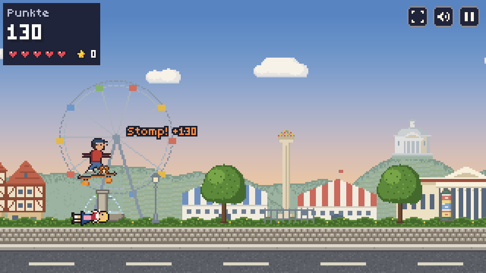

## What's in it

| Part | What it does |
|---|---|
| **[The game](#highlights)** | The skate runner itself: real Stuttgart places, tricks, items, a kid mode, German and English, desktop and phone |
| **[Online Bestenliste](#features)** | A shared top 20 with nicknames, checked for plausible scores on the server |
| **[Feedback in the game](#feedback-from-inside-the-game)** | Players send a bug report or an idea and later see what became of it, without an account |
| **[Insights board](#insights-board)** | A private dashboard with anonymous play statistics and a ticket system for the feedback, linked to GitHub issues |
| **[Offline app and privacy](#privacy)** | Installable PWA that works offline; anonymous statistics that players can switch off |
| **[Releases](#development)** | CI on every push, releases by tag, a "Neu in dieser Version" screen for players |

## Highlights

| | |
|:-:|:-:|
| 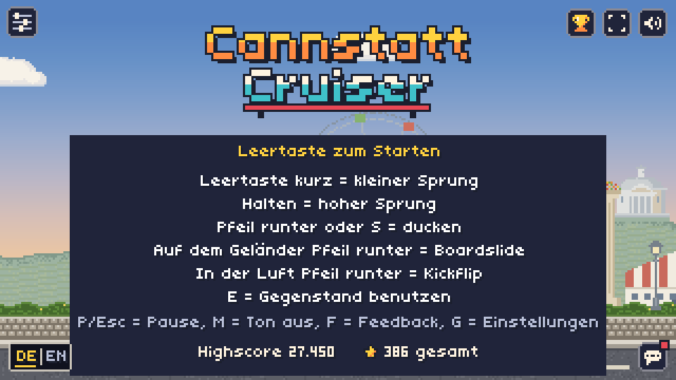 | 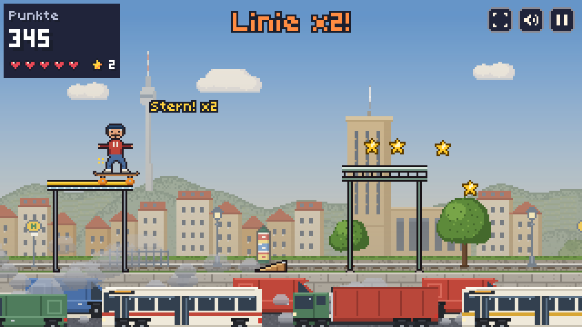 |
| Title screen with the controls | A stunt line in Stuttgart-Mitte: "Linie x2!" |
| 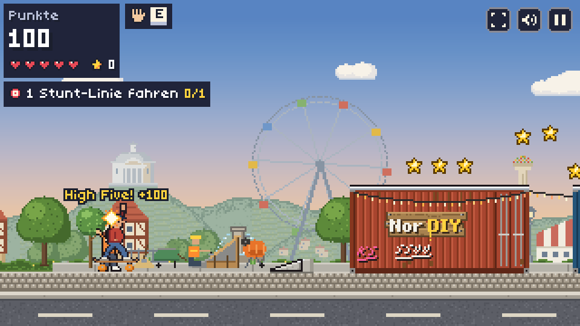 | 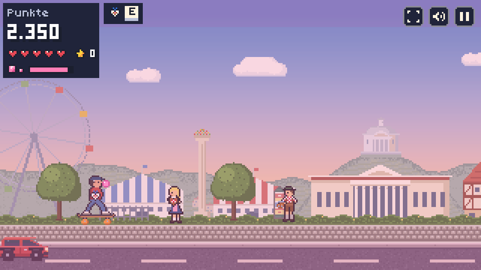 |
| High five at the NorDIY skatepark | Kindermodus: bubble gum and Lebkuchenherz |
| 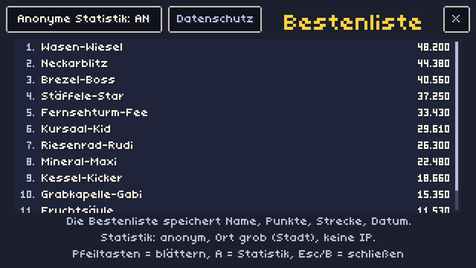 | 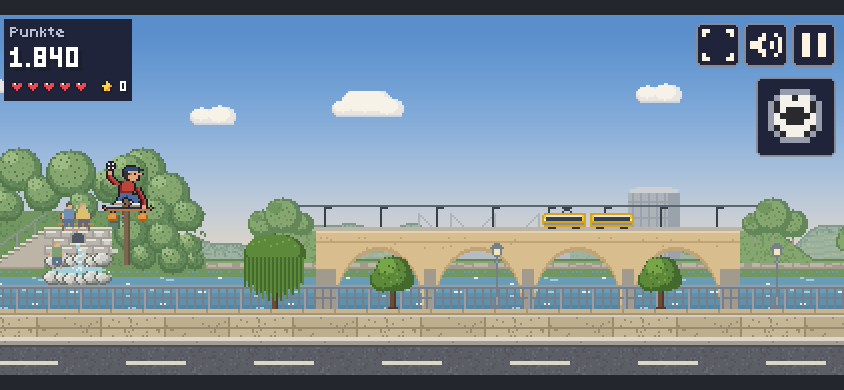 |
| The online "Bestenliste" | On a phone at the Neckar, with touch controls |

## Controls

| Action | Keyboard | Touch |
|---|---|---|
| Jump (tap = small ollie, hold = higher jump) | Space, ↑ or W (or a mouse click) | Tap anywhere, hold for higher |
| Duck | ↓ or S (held) | Swipe down |
| Boardslide (while grinding) | ↓ or S | Swipe down |
| Kickflip (in the air) | ↓ or S | Swipe down |
| Use the carried item / high five | E | The item button |
| Kicker ramp | Jump on the ramp | Tap on the ramp |
| Pause | P or Esc | Pause button |
| Sound on/off | M | Speaker button |
| Bestenliste (title screen) | B | Trophy button |
| Feedback | F | Pause menu or speech bubble on the title |
| Einstellungen (title screen) | G, or hold K for 3 s | Gear button, or hold the logo for 3 s |

On phones, landscape is the play orientation.

## Features

- **German and English:** German by default, English on the title with "DE | EN" (the first visit
  follows the browser language).
- **Real places:** Bad Cannstatt (Altstadt, Kursaal, the Cannstatter Wasen with Riesenrad,
  beer tents and Fruchtsäule, the Grabkapelle on the Württemberg), Am Neckar (the bridge with the
  Stadtbahn, the Mercedes-Benz Arena, the Mombachquelle) and Stuttgart-Mitte (Fernsehturm,
  Hauptbahnhof tower, Stäffele, vineyards and heavy traffic). The route rides back and forth
  between them.
- **Tricks:** ollies, ducking, stomps (land on a person's head, bounce off and catch what they
  carry), rail and bench grinds with a boardslide, kickflips, kicker ramps and stunt lines over
  ledges with a growing combo.
- **NorDIY skatepark:** a DIY park with containers, a crane, a cheering crowd and a skater who
  wants a high five.
- **Items:** catch a football, a Brezel or a Lebkuchenherz and use them: eat for health, throw
  the ball. Collect stars on the way.
- **Kindermodus:** kid-friendly pictures and texts, switched on in the settings (the gear on the
  title screen). Kid mode hides the gear; holding the logo (or K) for 3 s opens the settings to
  switch it off again.
- **Online Bestenliste:** a shared top 20 with nicknames, one entry per device (not in kid mode).
- **Offline and installable:** a PWA with a service worker. "App installieren" is always in the
  settings (until installed); phones also get it on game over after a good run ("×" snoozes it).
  Without the browser's install dialog it shows the steps (Android menu, iOS "Teilen"). After
  updates a "Neu in dieser Version" screen shows.
- **Feedback:** bug reports and ideas from inside the game (not in kid mode), see
  [Feedback from inside the game](#feedback-from-inside-the-game). The texts stay on the device;
  only each report's id and a random secret key go out to ask for its status.

## Feedback from inside the game

Players report a bug ("Fehler") or share an idea ("Idee") right from the pause menu or the title
screen. "Ansehen" shows exactly what will be sent, and the error log is only attached when the
player ticks it. "Mein Feedback" then lists what this device sent and what became of it; a red dot
marks news.

| | | |
|:-:|:-:|:-:|
| 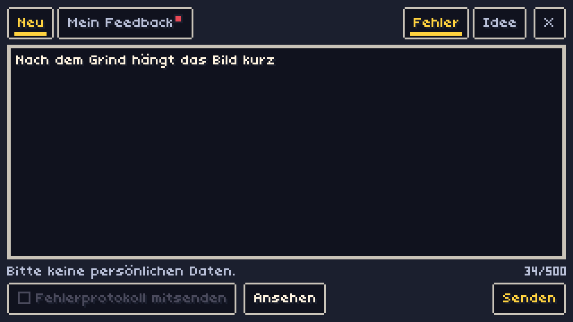 | 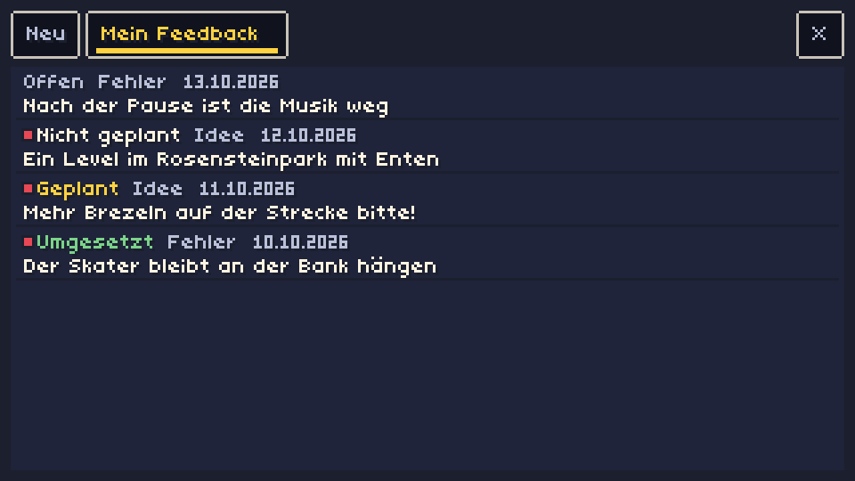 | 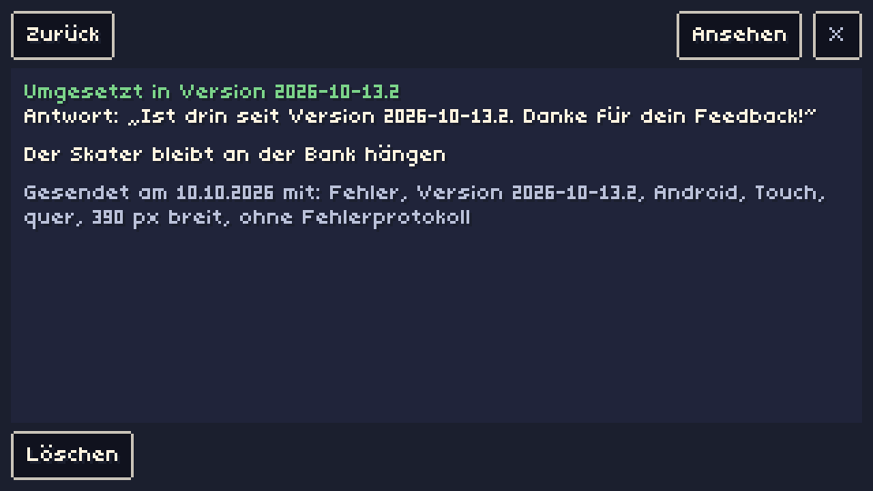 |
| Writing a bug report | "Mein Feedback": every report with its status | A done report with the reply |
| 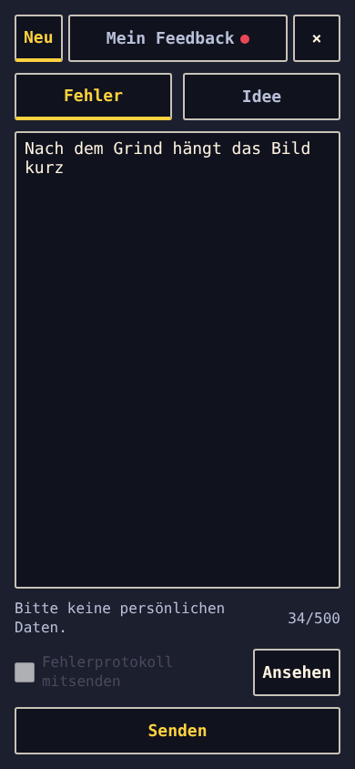 | 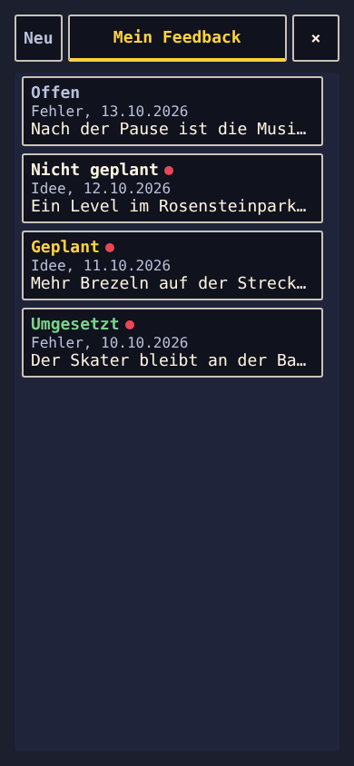 | 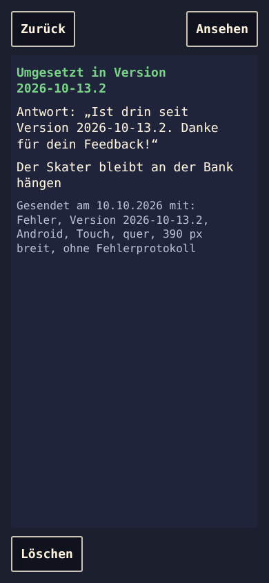 |
| On a phone held upright | Every status on the phone | The reply on the phone |

## Insights board

A hidden page (`insights.html`, never linked from the game, German only) for the owner, unlocked
with a token. The screenshots below show **dummy data**.

**Statistik:** anonymous aggregates of the play statistics over 7, 30, 90 or 365 days or
everything: sessions and runs per day, new and returning players, run length, distance and
points, input, system and kid mode, cities, regions, countries, game versions and the current
Bestenliste. A switch marks the owner's own devices as test devices so they can be left out.

**Feedback:** every report is a ticket with the status Neu, Geplant, Erledigt or Abgelehnt.
"Umsetzen" creates a GitHub issue (or links an existing one) and sets the ticket to Geplant; the
board keeps reading the issue's state from GitHub and offers "Abschließen" once the issue is
closed. Every step comes with a short reply that the player reads under "Mein Feedback",
for example "Ist drin seit Version 2026-10-13.2".

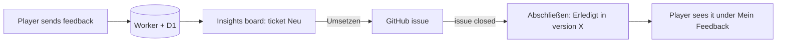

| | |
|:-:|:-:|
| 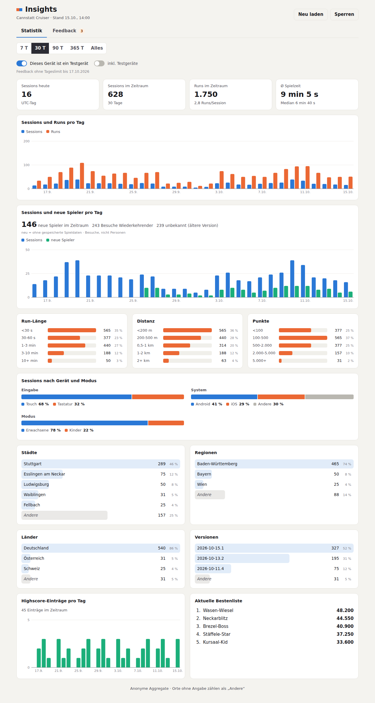 | 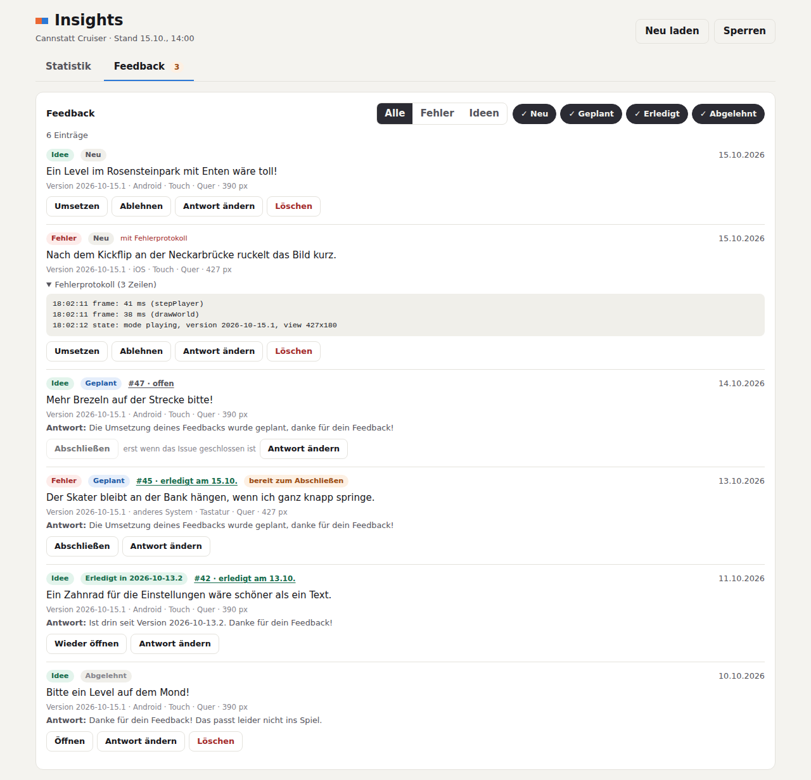 |
| Statistik (30 days, dummy data) | Feedback tickets with GitHub issues (dummy data) |

## Privacy

The game stores your records on your device. The online list keeps only nickname, score,
distance, run time and date. Anonymous play statistics (no IP address) can be switched off in
the game ("Anonyme Statistik"). Details: [Datenschutz](https://marvin-builds.github.io/cannstatt-cruiser/datenschutz.html)
([in English](https://marvin-builds.github.io/cannstatt-cruiser/datenschutz.html#en)).

## Development

Needs Node.js 22.

```sh
npm install
npm run dev        # dev server (test hook window.__game is on)
npm test           # Vitest unit tests
npm run build      # type-check and production build into dist/
npm run preview    # serve the build
npm run playtest   # Playwright screenshots + state log in playtest-output/
```

Regenerate the game screenshots in this README (after art changes):

```sh
npm run playtest -- --scenario scripts/scenarios/readme-shots.ts --viewports desktop,phone-landscape --name readme-shots
```

Regenerate the feedback and insights screenshots (dummy data from a faked worker, nothing goes
online):

```sh
npm run playtest -- --scenario scripts/scenarios/readme-feedback-shots.ts --viewports desktop,phone-portrait --name readme-feedback-shots
```

The highscore, statistics and feedback worker lives in [`server/`](server/README.md) with its
own `package.json` and tests (`cd server && npm install && npx vitest run`).

More docs:

- [docs/ARCHITECTURE.md](docs/ARCHITECTURE.md): modules, contracts, events
- [docs/TESTING.md](docs/TESTING.md): unit tests, test hooks, playtest harness
- [docs/SPEC.md](docs/SPEC.md): product spec
- [docs/ROADMAP.md](docs/ROADMAP.md): plans and status

**Releases:** CI tests and builds every push to `main`. A release deploys to GitHub Pages when a
tag `v<version>` is pushed, where `<version>` is the newest entry in `src/changelog.ts`.

## Tech

Vite + TypeScript + Canvas 2D, no game engine. All pixel art is drawn in code from palette sprite
strings (no image files), the sound effects are generated with WebAudio, and the game runs on a
fixed 60 Hz timestep. The online list, statistics and feedback run on a Cloudflare Worker with
a D1 database.
